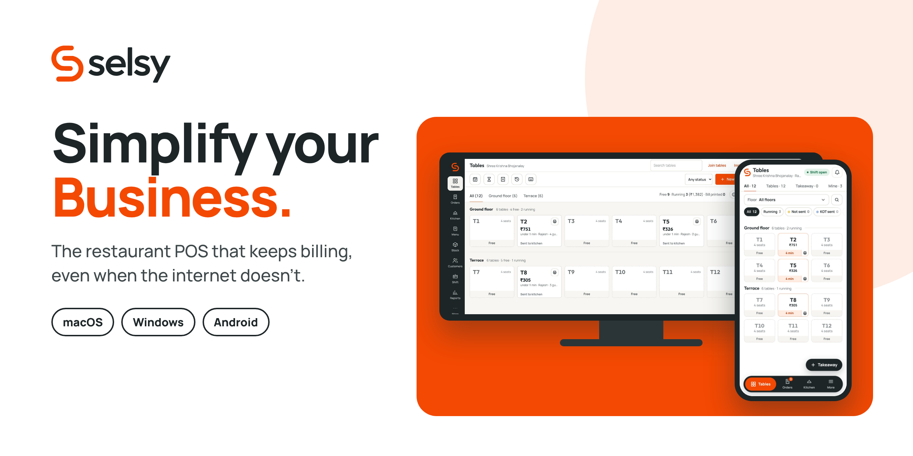

  

  
  
  

  <b>SELSY</b> is a restaurant POS for India: billing, kitchen, payments, stock and reports in one place. 
  This page is where the computer app is downloaded and where it updates itself from.

 

## Download

<table>
  <tr>
    <th align="left">Your computer</th>
    <th align="left">File to download</th>
  </tr>
  <tr>
    <td><b>Mac with Apple chip</b> (M1, M2, M3, M4…)</td>
    <td><code>SELSY-x.y.z-mac-arm64.dmg</code></td>
  </tr>
  <tr>
    <td><b>Mac with Intel chip</b></td>
    <td><code>SELSY-x.y.z-mac-x64.dmg</code></td>
  </tr>
  <tr>
    <td><b>Windows 10 or 11</b> (64-bit)</td>
    <td><code>SELSY-x.y.z-win-x64.exe</code></td>
  </tr>
</table>

  

> [!TIP]
> Not sure which Mac you have? Click the Apple menu → **About This Mac**. "Chip: Apple M…" means Apple chip; "Processor: Intel" means Intel.

 

## What SELSY does

<table>
  <tr>
    <td width="50%" valign="top">
      <h3>Fast billing</h3>
      Dine-in, takeaway and delivery. Tables, KOT straight to the kitchen screen, split bills and part payments.
    </td>
    <td width="50%" valign="top">
      <h3>Works offline</h3>
      Billing never stops when the internet does. Everything syncs to SELSY cloud once it is back.
    </td>
  </tr>
  <tr>
    <td valign="top">
      <h3>Phone POS and standby</h3>
      Waiters take orders from a phone. If the computer stops, a phone takes over billing, with no lost bills.
    </td>
    <td valign="top">
      <h3>Every way to pay</h3>
      Cash, UPI that matches itself to the bill, card machine, khata, wallet and points.
    </td>
  </tr>
  <tr>
    <td valign="top">
      <h3>Online orders in one screen</h3>
      Swiggy, Zomato and your own QR menu orders arrive in the same POS. WhatsApp offers bring customers back.
    </td>
    <td valign="top">
      <h3>Your data stays yours</h3>
      Locked on the computer, backed up to your own Google Drive, with a live Google Sheet of your sales.
    </td>
  </tr>
  <tr>
    <td valign="top">
      <h3>Stock and inventory</h3>
      Recipes, purchases, low-stock alerts and transfers between outlets.
    </td>
    <td valign="top">
      <h3>Reports and GST</h3>
      Daily sales, items, payments and GST-ready reports, exported to Excel.
    </td>
  </tr>
</table>

 

## Installing

<b>On a Mac</b>

 

1. Open the `.dmg` file you downloaded.
2. Drag **SELSY** into the **Applications** folder.
3. Open SELSY from Applications.
4. If macOS says it can't check the app, open **System Settings → Privacy & Security**, scroll down and click **Open Anyway**, then **Open**. You only do this once.

<b>On Windows</b>

 

1. Open the `.exe` file you downloaded.
2. If Windows shows "Windows protected your PC", click **More info → Run anyway**.
3. Follow the installer. SELSY opens when it finishes and adds a shortcut to the desktop.

<b>First start</b>

 

Enter the licence key you received from SELSY, or start with the sample restaurant to try it out. Setting up the restaurant takes a few minutes: name, tables, menu and the owner's PIN.

 

## Updates

SELSY keeps itself up to date. A new version downloads in the background and goes in **the next time SELSY restarts**, so a bill is never interrupted.

Every update carries SELSY's own signature. The app checks it before installing, so only real SELSY updates are put in.

Each version's changes are listed on the [Releases page](https://github.com/RajPatel676/selsy-releases/releases).

 

## Phone app

The **SELSY POS** app for Android phones and tablets works alone or alongside the computer. It is shared with each restaurant by SELSY and is coming to Google Play.

 

## Need help?

<table>
  <tr>
    <td><b>Call or WhatsApp</b></td>
    <td><a href="tel:+919173263967">+91 91732 63967</a></td>
  </tr>
  <tr>
    <td><b>Website</b></td>
    <td><a href="https://selsy.in">selsy.in</a></td>
  </tr>
</table>

 

   
  Simplify your Business. 
  © 2026 SELSY. This repository holds the released apps only; the source code is private.

